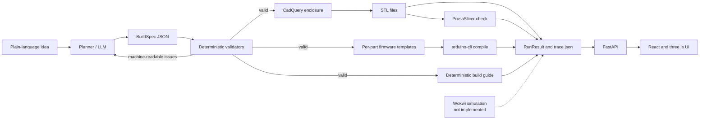

# SparkPlan

SparkPlan turns a plain-language hardware idea into a validated parts list and
wiring, a 3D-printable enclosure, compilable ESP32 firmware, and a build guide.
The LLM only proposes a structured `BuildSpec`; deterministic Python code
validates every part, pin, rail, behaviour, mesh and sketch. Ideas that need
parts outside the fixed catalog are refused with reasons instead of being
approximated.

## Quickstart

```sh
git clone https://github.com/Ash052006/SparkPlan.git
cd SparkPlan
uv sync --extra dev
uv run uvicorn api.app:app --host 127.0.0.1 --port 8000
```

In a second shell:

```sh
curl -s http://127.0.0.1:8000/health
curl -s http://127.0.0.1:8000/catalog | python3 -m json.tool | head
```

These checks need no LLM key. To plan an idea end to end, set the
`SPARKPLAN_LLM_*` variables described in [LLM configuration](#llm-configuration)
and `POST /plan` (the request returns a run id, then poll `GET /runs/{run_id}`).

## Architecture



The pipeline stages are `plan`, `validation`, `geometry`, `slicing`,
`firmware_generation`, `firmware_compile` and `guide`. A refusal stops before
creating a run directory.

## The reliability principle

The LLM proposes; code verifies.

- The LLM produces one structured `BuildSpec` and nothing executable. It does
  not write geometry or firmware.
- Pydantic enforces the schema. Deterministic validators then check catalog
  membership, pin capability, GPIO conflicts, rail voltage and current, I2C
  wiring, behaviour references and layout hints.
- Validation failures go back to the LLM as machine-readable `Issue` objects,
  inside a bounded repair loop. A half-valid build is never labelled successful.
- Geometry comes from CadQuery driven by catalog dimensions. Firmware comes
  from per-part templates. Neither is generated by the LLM.
- Unsupported ideas are refused with reasons, missing capabilities and the
  closest supported alternative where available. They are never approximated
  with a similar catalog part.

## Evaluation

The numbers below come from [`eval/REPORT.md`](eval/REPORT.md). That report is a
**scripted FakeLLM harness run, not a live-model benchmark**. It validates the
harness and scoring, not live model reliability.

| Scope | Passed | Total | Pass rate |
| --- | ---: | ---: | ---: |
| All selected cases | 4 | 4 | 100.0% |
| Build cases | 2 | 2 | 100.0% |
| Refusal cases | 2 | 2 | 100.0% |

Slicing and compilation were skipped in that scripted run: `0` attempted and
`2` skipped for each stage. Skipped stages are never counted as passes. The raw
result is committed at
[`docs/phase9/eval-scripted.json`](docs/phase9/eval-scripted.json).

## Verification

Compilation, slicing, simulation and behavior checking are separate claims.

| Claim | Status | Evidence |
| --- | --- | --- |
| Rule-based validation | Verified | Deterministic validators; successful runs record `validated: true` in `trace.json`. |
| Firmware compiles | Verified for supported fixtures and live runs | [Firmware CI](https://github.com/Ash052006/SparkPlan/actions/runs/39642266683), plus the real run in [`docs/phase9/repair-trace.json`](docs/phase9/repair-trace.json). |
| STL slices | Verified in CI and live runs | [CI tests, slicing and web](https://github.com/Ash052006/SparkPlan/actions/runs/39780463915), plus the same trace. |
| Simulation | **Skipped / not implemented** | No Wokwi integration. `trace.json` records `"simulated": "skipped"`. |
| Behavior checked | **Not implemented** | No serial expectations, simulator run or behavior harness. |

What the evidence does mean: the supported fixtures compile with the pinned
ESP32 toolchain, the generated meshes slice to nonempty G-code, and the
deterministic validators accept the recorded builds. What it does not mean:
that a physical device was assembled or tested.

## Limitations

- **Not physically built.** Nothing in this repository has been printed, wired,
  flashed or measured. There is no physical-build photograph or test result.
- **Dimensions are datasheet-sourced or estimated.** Enclosure fit, screw-post
  engagement, cable egress and lid clearance are unverified on hardware.
- **Simulation is absent.** There is no `sparkplan/simulation/` package and no
  Wokwi model mapping in the catalog. Because no part has a Wokwi model, no part
  is simulated. Behaviour checking is not implemented.
- **The eval is scripted.** The 4-case report uses `FakeLLM`, not a live model.
  It is not a live pass rate.
- **CI is not a physical test.** A green compile or slice job does not prove
  electrical safety, print quality or that the parts fit together.
- **Background jobs and rate limits are process-local.** They do not coordinate
  across multiple API workers or hosts.
- **Real LLM output varies.** The repair loop is bounded; a model can still
  fail to produce a valid build and will then be reported as failed.

## Roadmap

- **MCP integration.** Expose the engine as an MCP stdio server with
  `design_hardware`, `list_parts` and `explain_refusal` tools.
- **One physical build.** Print the enclosure, wire the parts, flash the
  firmware, record the serial output and compare it with the build guide.
- **Wokwi simulation and behavior checks.** Map the catalog to official Wokwi
  parts and never mark simulation as passed unless it actually ran.

## Setup

```sh
brew install uv                       # or: pip install uv
uv python install 3.11
uv sync --extra dev
```

The preferred geometry engine is CadQuery. If its OCP stack cannot be
installed, `uv sync --extra build123d` installs build123d instead; the geometry
package picks whichever is importable. Do not install both: the
`cadquery-ocp-novtk` package that build123d pulls in breaks `import cadquery`.

## API

The canonical API runs plans in bounded background workers and is polled.

| Endpoint | Purpose |
| --- | --- |
| `POST /plan` | `{"idea": "..."}` (maximum 500 characters) returns `202` and `{"run_id": "..."}`. |
| `GET /runs/{run_id}` | Poll for `status: "running"` or the final `RunResult`. |
| `GET /runs/{run_id}/files/{name}` | Download one allowlisted artifact. |
| `GET /runs/{run_id}/bundle.zip` | Download all available artifacts in one ZIP. |
| `GET /catalog` | Catalog summary. |
| `GET /health` | Health check. |

`POST /plan` is limited to 10 requests per 60 seconds per client IP by default
(`SPARKPLAN_RATE_LIMIT`, `SPARKPLAN_RATE_WINDOW_S`). CORS allows the Vite
development origins by default (`SPARKPLAN_CORS_ORIGINS`). Invalid requests
return `422`; unknown runs or files return `404`; rate limiting returns `429`;
a full queue or missing LLM configuration returns `503`.

The synchronous `/v2` API and the older `/v1` compatibility endpoints remain
available. They share the catalog and pipeline but are not the recommended
integration path.

## Web UI

The single-page UI polls `/plan` and `/runs/{id}`, renders validation, the STL
enclosure, firmware and the Markdown guide, and downloads the run bundle.

```sh
cd web
npm ci
npm run dev
```

The Vite dev server proxies `/plan`, `/runs`, `/catalog` and health routes to
`http://localhost:8000`. To use another API port:

```sh
uv run uvicorn api.app:app --host 127.0.0.1 --port 8010
SPARKPLAN_API_URL=http://127.0.0.1:8010 npm run dev -- --port 5180
```

The Playwright checks use mocked API responses and need no backend:

```sh
npm run typecheck
npm run build
npx playwright install chromium
npm run test:e2e
```

## LLM configuration

The client is provider-agnostic and speaks an OpenAI-compatible API.

```sh
export SPARKPLAN_LLM_PROVIDER=openai_compat   # or groq
export SPARKPLAN_LLM_BASE_URL=https://api.groq.com/openai/v1
export SPARKPLAN_LLM_API_KEY=...
export SPARKPLAN_LLM_MODEL=llama-3.3-70b-versatile
export SPARKPLAN_LLM_MAX_TOKENS=1800
```

The API loads a local `.env` on startup when present. Unit tests never touch the
network; they inject `FakeLLM` with scripted responses.

## Tests and linting

```sh
uv run ruff check .
uv run black --check .
uv run pytest
```

Or use the Makefile:

```sh
make test
make lint
```

## Repository layout

```text
catalog/            parts.json, power, GPIO and capability data
sparkplan/
  models/           BuildSpec, Issue, Refusal (Pydantic v2)
  catalog/          catalog loader and validation
  llm/              LLMClient protocol, FakeLLM, OpenAI-compatible adapter
  validators/       deterministic structural, pin, power, I2C and behaviour checks
  planner/          idea -> BuildSpec, repair loop and refusal path
  geometry/         enclosure layout, CadQuery shell, STL export, slicing
  firmware/         template engine, pinned manifest, arduino-cli wrapper
  guide/            deterministic Markdown guide
  pipeline/         canonical stage orchestration, run models and traces
api/                FastAPI app and background run manager
eval/               eval harness, cases and scripted evidence
web/                React, Vite and three.js UI
tests/              pytest suites; no network, FakeLLM only
docs/               phase progress, design notes and demo evidence
```

Units are millimetres, volts and milliamps.
